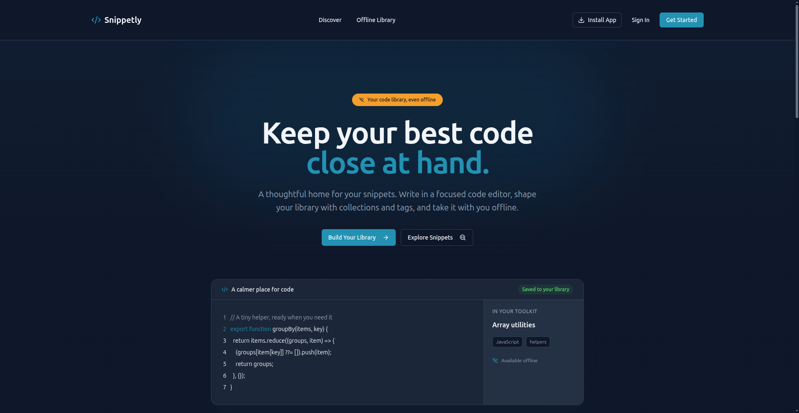
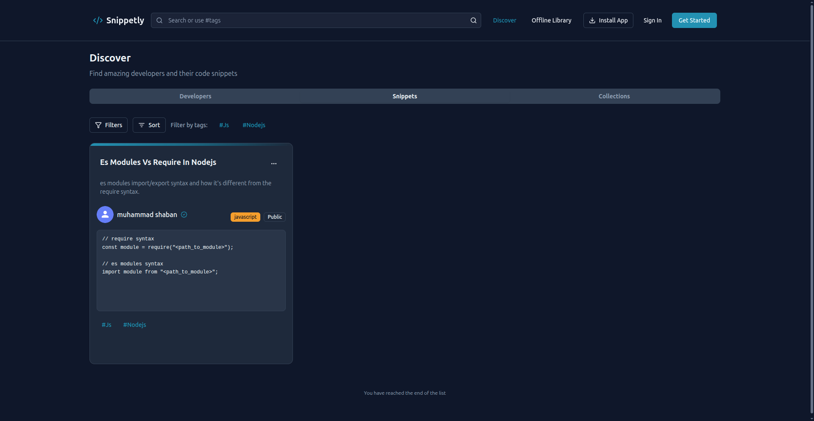
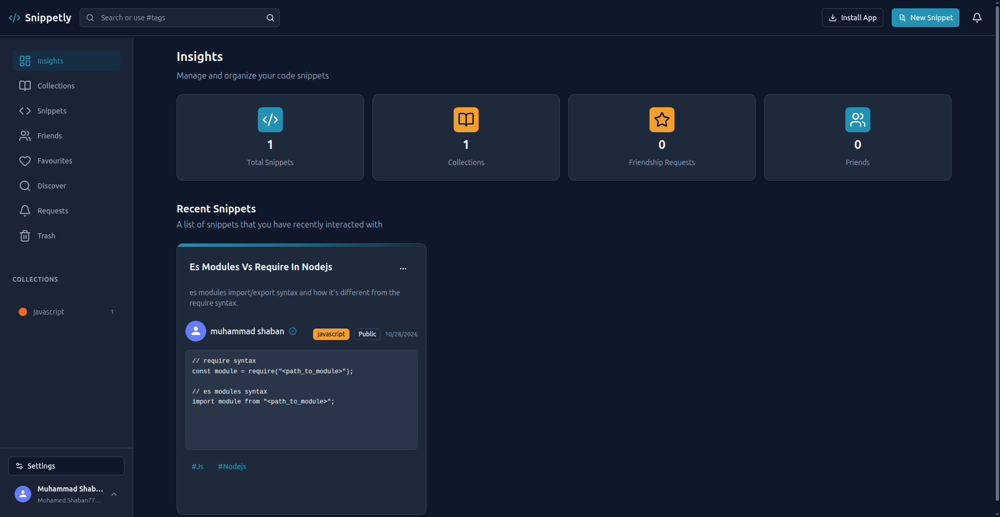
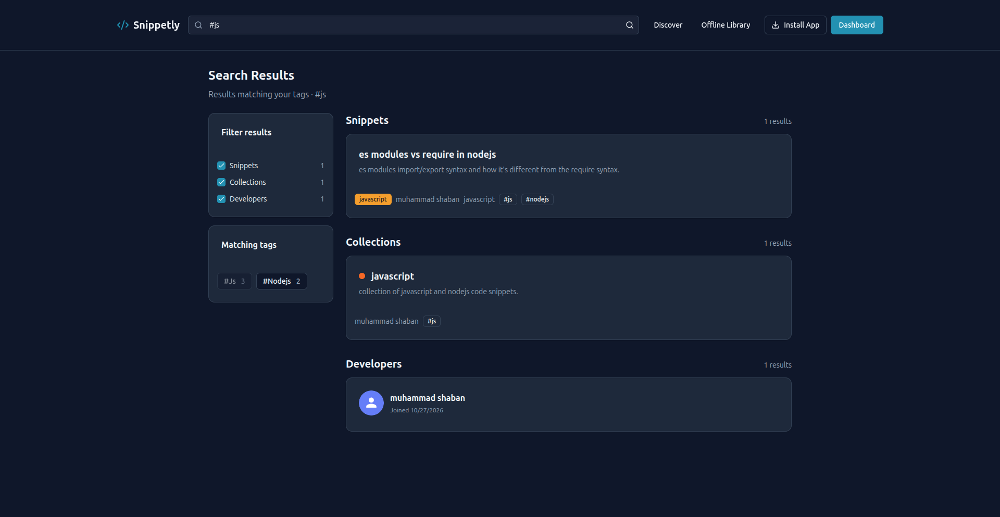
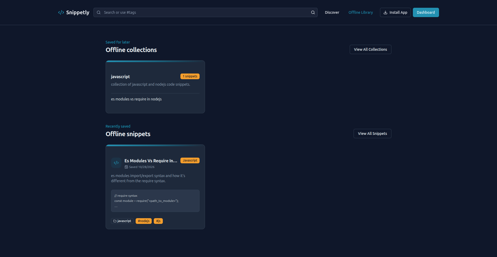

# Snippetly

Snippetly is my personal code-snippet library, built to solve a problem I have faced: keeping useful code easy to find, organized in one place, and available when I am offline. It lets me collect snippets into collections, search and rediscover them, and save selected snippets and collections for offline use.

This is a personal project, not a starter kit or a community contribution project. The local setup notes below are here for maintenance and experimentation; they are not a contribution guide.

<p align="center">
  <a href="https://snippetly-eta.vercel.app" target="_blank" rel="noopener noreferrer">
    
  </a>
</p>

## Screenshots

| Screenshot | What it shows |
| --- | --- |
|  | **Landing page** — Public introduction to Snippetly, with calls to build or explore a code library. |
|  | **Discover** — Browse public snippets, developers, and collections, with filters and sorting. |
|  | **Dashboard** — View library insights, collections, and recently accessed snippets. |
|  | **Search results** — Find matching snippets, collections, and developers, including tag matches. |
|  | **Offline library** — Access saved collections and snippets without a network connection. |

## What it does

- **Snippets and collections** — Write and edit code in a syntax-aware editor, organize snippets into named collections, and use tags to make them easier to find.
- **Search and discovery** — Search snippets, collections, and developer profiles. Browse public content, filter results, and sort or paginate larger lists.
- **Offline library and installable app** — Install Snippetly as a PWA and save individual snippets or filtered collections for offline reading. Previously cached pages can also be used when the network is unavailable.
- **Profiles and social features** — Manage a developer profile, connect with other developers through friend requests, and favourite profiles and content.
- **Notifications** — Keep up with in-app notifications and optionally enable browser push notifications for public snippets published by accepted friends.
- **Insights and library management** — Review activity and content statistics, and restore or permanently remove items in the trash.
- **Account and security settings** — Register or sign in with email and password or Google, manage account details and active sessions, and configure appearance and app-installation settings.

## Design and architecture

Some architectural decisions in Snippetly are explicitly inspired by **Vendure** and **NestJS**. In particular, the server uses dependency-injected services, clear API/domain boundaries, and event-driven workflows. Snippetly is its own application and does not use Vendure or NestJS as its server framework.

The repository is a pnpm workspace with a React client, a TypeScript/Express API, and shared packages for common schemas and server-agnostic test infrastructure. `@snippetly/testing` provides reusable test-server lifecycle and API-client helpers; the server's bootstrap and data fixtures are supplied by an adapter in `apps/server/e2e/support`, so the testing package does not depend back on the server. The API uses TypeORM with PostgreSQL; its search strategy uses PostgreSQL full-text search, with a SQLite strategy available in the shared application configuration.

## Technology

- **Client:** React, TypeScript, Vite, TanStack Router and Query, Tailwind CSS, CodeMirror
- **API:** Node.js, Express, TypeScript, TypeORM, PostgreSQL
- **Offline and notifications:** PWA service worker, IndexedDB, Web Push
- **Integrations:** Vercel, Neon, Redis, Upstash QStash, UploadThing, Nodemailer

## Local setup

Local instructions are provided for maintaining or experimenting with the project. The hosted app and production services have separate configuration.

### Requirements

- Node.js 20 or newer
- pnpm 10
- Docker Compose, for the local PostgreSQL service

### Install dependencies

Run from the repository root:

```bash
pnpm install
```

### Configure environment files

Create these files locally; do not put credentials in source control:

- `apps/server/.env` — local API and database settings. The API loads this file in development.
- `apps/server/.env.development` — optional development-only overrides, loaded after `.env`.
- `apps/server/.env.production` — optional production-mode settings for local production runs; do not use production credentials for local development.
- `apps/client/.env` — Vite client settings.

For a local database, start the PostgreSQL service from the repository root:

```bash
docker compose -f docker-compose.dev.yaml up -d
```

That compose file exposes PostgreSQL on host port `6543`, with the local database, username, and password set in the compose configuration. Set the following in `apps/server/.env` to match it:

```dotenv
DB_HOST=localhost
DB_PORT=6543
DB_USER=snippetly
DB_PASSWORD=snippetly
DB_NAME=snippetly
DB_SCHEMA=public
```

The API enables TypeORM schema synchronization in development. Production uses migrations instead. Additional server settings you may need:

| Variable                                                                                                          | Purpose                                                                                                                                                                                                                    |
| ----------------------------------------------------------------------------------------------------------------- | -------------------------------------------------------------------------------------------------------------------------------------------------------------------------------------------------------------------------- |
| `HOST`, `PORT`                                                                                                    | Bind address and port when running the API outside its default local configuration.                                                                                                                                        |
| `DB_SSL`, `DB_CHANNEL_BINDING`                                                                                    | Optional PostgreSQL connection settings; set to `true` when required by the database provider.                                                                                                                             |
| `GOOGLE_CLIENT_ID`                                                                                                | Google sign-in client ID for the API.                                                                                                                                                                                      |
| `VAPID_PUBLIC_KEY`, `VAPID_PRIVATE_KEY`, `VAPID_SUBJECT`                                                          | Configure Web Push. Generate a local key pair with `pnpm --filter @snippetly/server exec web-push generate-vapid-keys`; use a `mailto:` address or HTTPS URL for the subject.                                              |
| `REDIS_URL`                                                                                                       | Redis connection used for production caching. Local development uses in-memory caching.                                                                                                                                    |
| `QSTASH_TOKEN`, `QSTASH_URL`, `QSTASH_JOBS_CALLBACK_URL`, `QSTASH_CURRENT_SIGNING_KEY`, `QSTASH_NEXT_SIGNING_KEY` | Production background-job delivery and webhook verification. Local development uses a dummy queue. The callback URL must point to the deployed API jobs endpoint (`/api/v1/developer/jobs` with the default API prefixes). |
| `GMAIL_APP_EMAIL`, `GMAIL_APP_PASSWORD`                                                                           | Production email transport credentials. Local development uses a dummy email transport.                                                                                                                                    |
| `ACCOUNT_VERIFICATION_CALLBACK_URL`, `PASSWORD_RESET_CALLBACK_URL`, `IDENTIFIER_CHANGE_CALLBACK_URL`              | Client URLs used in account emails.                                                                                                                                                                                        |
| `RUN_STARTUP_INITIALIZATION`                                                                                      | Enable server startup initialization where appropriate.                                                                                                                                                                    |

In `apps/client/.env`, set:

```dotenv
VITE_API_URL=http://localhost:3000
VITE_GOOGLE_CLIENT_ID=your-google-client-id
```

Set `VITE_API_URL` to the API base URL used by the client. Google sign-in is optional; when enabled, the client and API must use the corresponding Google client ID. Optional integrations can be left unconfigured during local development.

### Build packages

Build all packages in the workspace recursively from the repository root:

```bash
pnpm build:all
```

### Run the app

Start the API and client together from the repository root:

```bash
pnpm dev:server-client
```

Or run either workspace separately:

```bash
pnpm --filter @snippetly/server dev
pnpm --filter @snippetly/client dev
```

The local API defaults to port `3000`; Vite prints the client URL when it starts.

### Production configuration notes

The hosted client and API are deployed separately. Production requires a PostgreSQL connection and the relevant provider credentials in the deployment environment rather than local `.env` files. Configure email callback URLs, Google sign-in, Redis, QStash, and VAPID keys only for the services you enable. Apply database migrations as part of the production release; production schema synchronization is disabled.

## License

MIT
